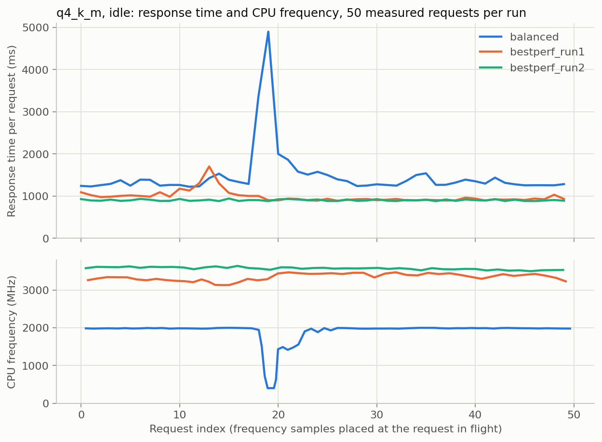
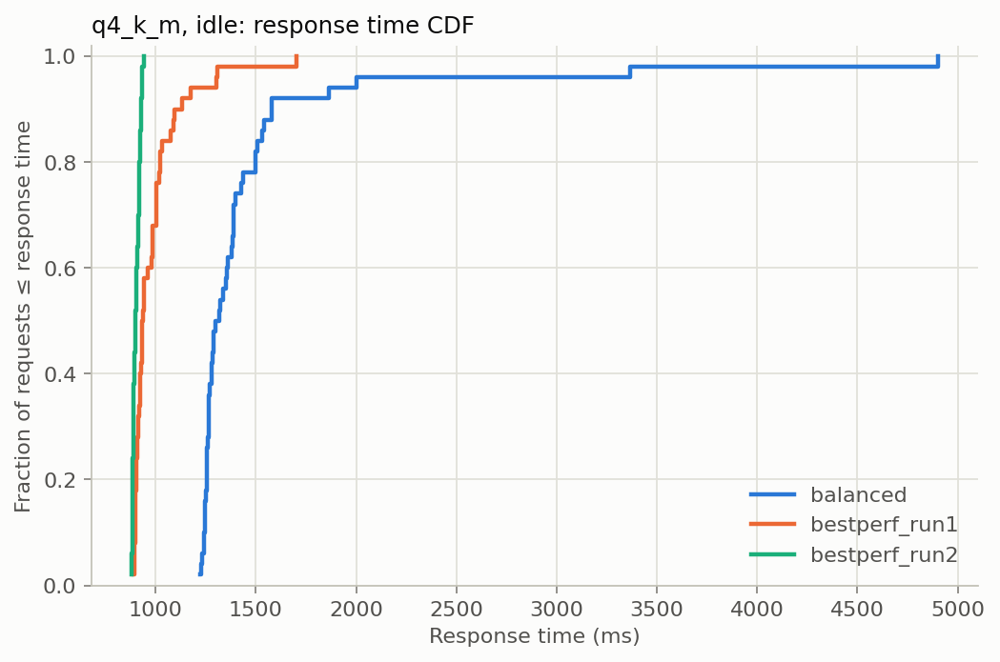
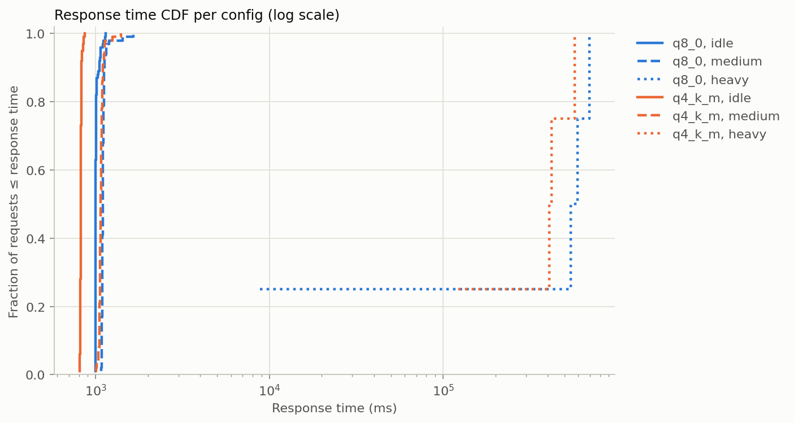
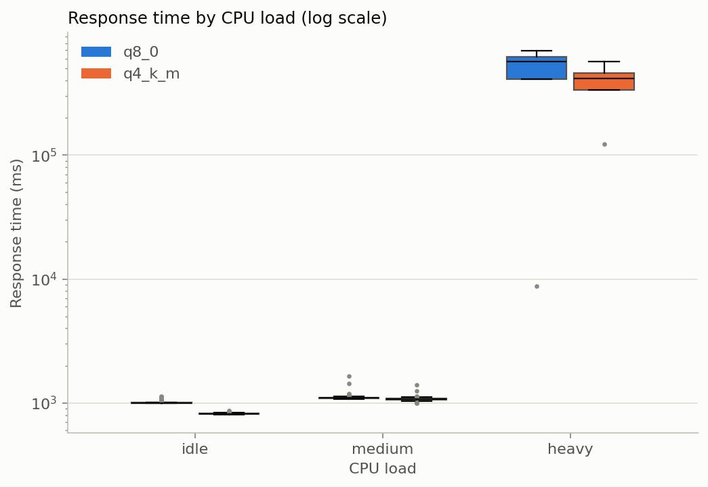
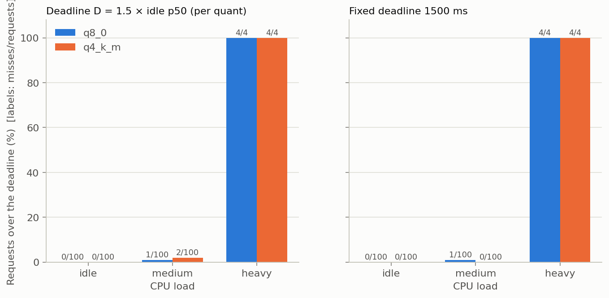
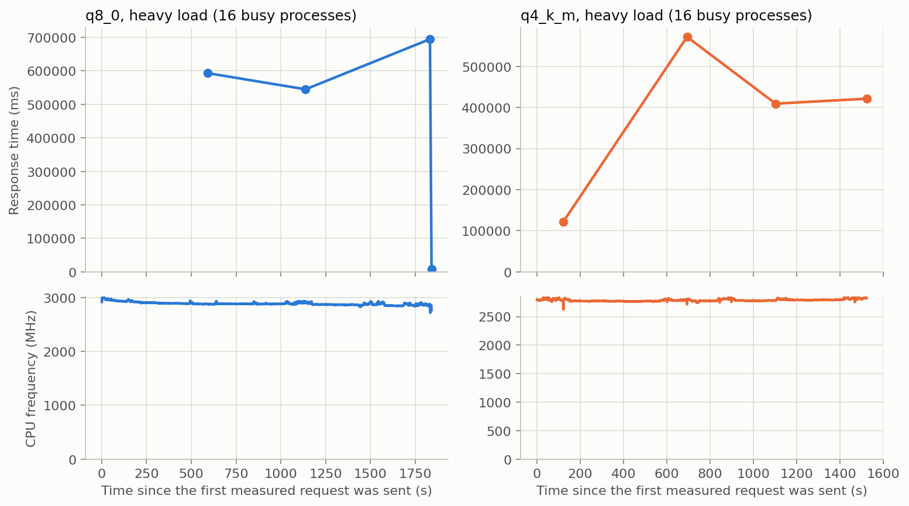

# How predictable is a small language model on a busy CPU?

A small, honest measurement project: how do quantization level and CPU
contention affect the response time **and its predictability** (jitter, tail
response time, deadline misses) of a small language model running locally with
llama.cpp?

**Why it matters.** Real-time systems care about the worst case, not the
average: a control loop that gets its answer on time 99 % of the time still
misses deadlines. Small language models are increasingly proposed for robots and
edge devices, where they share the CPU with other work, so their tail response
time under contention is the number that matters.

> **Status:** the quantization × CPU-load experiment has been run once (idle and
> medium load: 2 passes × 50 requests per config; heavy load: 1 pass × 4 requests per
> config, because heavy requests take minutes). The measurement harness, the data and
> the results are here. Not done: a real-time-style mitigation and other models.

## Setup

| | |
|---|---|
| CPU | AMD Ryzen 7 7730U, 8 cores / 16 threads |
| RAM | 15.3 GB |
| OS | Windows 11 (10.0.26200), laptop on AC power |
| Runtime | llama.cpp `llama-server`, prebuilt release **b12177** (CPU x64; `version: 0.9.0-dev (build 12177, commit 6c01da627)`, Clang 20.1.8) |
| Model | Qwen2.5-0.5B-Instruct, GGUF, Q8_0 and Q4_K_M (SHA256 of both files in `results/*/meta_*.json`) |
| Fixed settings | same prompt, temperature 0, seed 42, `n_predict=64` with `ignore_eos` (always exactly 64 tokens), `-t 4`, context 2048, one slot, prompt cache off |
| Per config | Idle and medium: 5 warm-up requests (kept in `raw.csv`, flagged `warmup`, excluded from analysis), then 50 measured requests, sequential. Heavy: 1 warm-up + 4 measured. |
| Between configs | Wait until the CPU temperature reads below 60 °C (checked every 5 s), at least 60 s and at most 300 s; the actual wait and temperatures are in `cooldowns.csv`. The first config of a run does not wait. |

**How it is measured.** A Python client sends each request to the local HTTP
API with `stream: true` and timestamps everything on its own monotonic clock
(`time.perf_counter`):

- **TTFT**: request sent → first streamed content chunk arrives (includes
  prompt processing of the ~15-token prompt).
- **Response time** (end-to-end latency): request sent → final chunk arrives.
  This is wall-clock time, not CPU execution time: time spent waiting for
  the CPU counts too.
- **Tokens/s (end-to-end)**: 64 / response time (in seconds). A decode-only rate and per-token
  arrival times are also stored in `raw.csv`, next to the server's own
  `timings` for comparison.
- A background recorder reads CPU frequency (effective, from the Windows
  `% Processor Performance` counter × nominal frequency) and an ACPI
  temperature about once a second into `freq.csv`.
- Per-run metadata (CPU, OS, power plan, llama.cpp version string, model hash,
  settings) goes into `meta_<run_id>.json`.

## First finding: idle baseline, Balanced vs Best performance

While testing the harness, one idle run (Q4_K_M, no other load) under the
Windows **Balanced** power plan showed a response-time spike with no contention at
all. I then repeated the idle run twice with the Windows power mode set to
**Best performance**.

**Caveat: this is not an apples-to-apples comparison.** The Best-performance
runs also ran at a much higher clock (median 3345 and 3579 MHz) than the
Balanced run (median 1984 MHz, no boost), so most of the difference in
absolute response time comes from clock speed, not only from the dip. Each setting
has one or two runs of 50 requests; treat everything below as an observation,
not a result.

Response time, TTFT and throughput (measured requests only, n = 50 per run):

| run | metric | mean | std | p50 | p95 | p99 | max |
|---|---|---|---|---|---|---|---|
| balanced | TTFT (ms) | 142.2 | 117.9 | 122.6 | 174.8 | 576.9 | 949.4 |
| balanced | Response time (ms) | 1472.4 | 590.5 | 1306.9 | 1938.6 | 4148.1 | 4900.2 |
| balanced | Tokens/s | 46.3 | 7.7 | 49.0 | 51.8 | 52.2 | 52.4 |
| bestperf_run1 | TTFT (ms) | 78.9 | 12.9 | 75.6 | 102.8 | 122.5 | 129.2 |
| bestperf_run1 | Response time (ms) | 988.8 | 140.5 | 935.7 | 1246.3 | 1509.5 | 1703.0 |
| bestperf_run1 | Tokens/s | 65.7 | 6.9 | 68.4 | 71.4 | 71.8 | 71.9 |
| bestperf_run2 | TTFT (ms) | 71.0 | 9.7 | 67.1 | 98.4 | 101.1 | 101.9 |
| bestperf_run2 | Response time (ms) | 903.9 | 17.5 | 899.1 | 932.8 | 938.6 | 943.2 |
| bestperf_run2 | Tokens/s | 70.8 | 1.4 | 71.2 | 72.5 | 72.6 | 72.6 |

CPU frequency and temperature during each run:

| run | freq min (MHz) | freq median (MHz) | freq max (MHz) | samples < 1500 MHz | temp min–max (°C) |
|---|---|---|---|---|---|
| balanced | 398.8 | 1984.4 | 1998.8 | 10 of 79 | 43.9–48.9 |
| bestperf_run1 | 3131.3 | 3345.3 | 3561.4 | 0 of 54 | 83.8–94.8 |
| bestperf_run2 | 3499.6 | 3579.4 | 3825.8 | 0 of 49 | 81.8–92.8 |





Observations:

- In the Balanced run, the CPU frequency dropped to about 400 MHz for a few
  seconds, and requests 18–21 took 3365, 4900, 2001 and 1862 ms against a
  median of 1307 ms. The response-time spike and the frequency drop line up in time.
  The temperature stayed at 44–49 °C, so this was not thermal throttling. I
  do not know the cause (a background task or the power-plan frequency policy
  are possibilities I have not tested).
- Neither Best-performance run shows such a dip (no frequency samples below
  3100 MHz).
- Run-to-run variation is not negligible even at idle: the two
  Best-performance runs differ in response-time std (140.5 ms vs 17.5 ms) and in
  median clock (3345 vs 3579 MHz). A deadline defined from an idle median
  would shift accordingly, so the contention experiments will repeat runs.
- Under Best performance the reported temperature was 82–95 °C with only four
  busy threads, which makes thermal throttling a real risk for the all-core
  load runs.

## Contention results

2 quantizations (Q8_0, Q4_K_M) × 3 CPU loads, where the load is a number of
busy-loop processes (`slm_bench/cpu_stress.py`) running next to the server: idle
(0), medium (8) and heavy (16 = all logical cores). Run on AC power with the
Windows power mode set to Best performance (recorded in the metadata).

- **Idle and medium** (`results/contention_v2`, run id `contention_v2`): 2 passes with
  different seeded random config orders, 50 measured requests per config and pass, so n = 100
  per config. Orders: pass 1 = `q8_0_medium, q4_k_m_idle, q8_0_idle, q4_k_m_medium`; pass 2 =
  `q8_0_idle, q8_0_medium, q4_k_m_idle, q4_k_m_medium`.
- **Heavy** (same folder, run id `contention_heavy`): run afterwards, separately, with 1 warm-up
  and 4 measured requests per config and one pass, because a single heavy request took
  between 8.8 s and 694.5 s (the two warm-ups took 290.3 s and 757.4 s). n = 4 per config is far too small for percentiles; read the heavy rows
  as individual requests, not as a distribution.

Response time in ms (measured requests, both passes pooled; heavy: one pass). Jitter = p99 − p50.
Full tables, including TTFT, tokens/s and every pass separately: `results/contention_summary.csv`.

| quant | load | n | mean | std | p50 | p95 | p99 | max | jitter |
|---|---|---|---|---|---|---|---|---|---|
| Q8_0 | idle | 100 | 1009.1 | 27.9 | 998.9 | 1064.9 | 1131.0 | 1137.5 | 132.1 |
| Q8_0 | medium | 100 | 1109.4 | 66.4 | 1096.8 | 1146.7 | 1432.9 | 1649.7 | 336.1 |
| Q8_0 | heavy | 4 | 460229.0 | 307356.2 | 568807.1 | 679251.2 | 691450.6 | 694500.4 | 122643.4 |
| Q4_K_M | idle | 100 | 821.8 | 8.8 | 820.1 | 835.5 | 854.5 | 865.9 | 34.4 |
| Q4_K_M | medium | 100 | 1074.8 | 43.8 | 1069.5 | 1122.4 | 1246.6 | 1394.8 | 177.1 |
| Q4_K_M | heavy | 4 | 381131.0 | 187754.6 | 415282.6 | 549162.2 | 567208.6 | 571720.2 | 151926.0 |

The four heavy Q8_0 requests took 592.8, 544.8, 694.5 and 8.8 s; the four Q4_K_M requests
took 122.2, 571.7, 409.2 and 421.3 s (in this order; `raw.csv`).

Deadline misses (response time **above** the deadline). D = 1.5 × the idle p50 of the same
quantization, pooled over both passes (Q8_0: 1498.4 ms, Q4_K_M: 1230.2 ms); the fixed
deadline is 1500 ms. File: `results/contention_deadline_misses.csv`.

| quant | load | n | misses above D | misses above 1500 ms |
|---|---|---|---|---|
| Q8_0 | idle | 100 | 0 | 0 |
| Q8_0 | medium | 100 | 1 (1 %) | 1 (1 %) |
| Q8_0 | heavy | 4 | 4 (100 %) | 4 (100 %) |
| Q4_K_M | idle | 100 | 0 | 0 |
| Q4_K_M | medium | 100 | 2 (2 %) | 0 |
| Q4_K_M | heavy | 4 | 4 (100 %) | 4 (100 %) |

CPU frequency and temperature during the measured requests of each config, to tell
contention from throttling (`results/contention_thermal.csv`):

| quant | load | response p50 (ms) | freq min (MHz) | freq median (MHz) | temp max (°C) | temp at config start, max (°C) |
|---|---|---|---|---|---|---|
| Q8_0 | idle | 998.9 | 3564.0 | 3953.4 | 74.8 | 51.9 |
| Q8_0 | medium | 1096.8 | 2964.2 | 2997.3 | 73.8 | 49.9 |
| Q8_0 | heavy | 568807.1 | 2717.7 | 2883.4 | 79.8 | 59.9 |
| Q4_K_M | idle | 820.1 | 3674.6 | 3875.4 | 71.8 | 48.9 |
| Q4_K_M | medium | 1069.5 | 2988.3 | 3020.4 | 71.8 | 53.9 |
| Q4_K_M | heavy | 415282.6 | 2625.9 | 2784.1 | 73.8 | 49.9 |









Observations (measured numbers only; none of this is a controlled comparison of causes):

1. **Idle is very stable.** Pooled p50 was 998.9 ms (Q8_0) and 820.1 ms (Q4_K_M), the latter
   17.9 % lower; jitter (p99 − p50) was 132.1 and 34.4 ms. No request missed a deadline.
2. **Medium load raised p50 by 9.8 % (Q8_0: 998.9 → 1096.8 ms) and 30.4 % (Q4_K_M: 820.1 →
   1069.5 ms)**, so the 179 ms gap between the models at idle shrank to 27 ms. The median CPU
   clock fell at the same time (Q8_0 3953 → 2997 MHz, −24 %; Q4_K_M 3875 → 3020 MHz, −22 %),
   so this experiment cannot separate "the busy processes took CPU time" from "the clock was
   lower".
3. **Medium load widened the tails a little.** p99 was 1432.9 ms (Q8_0) and 1246.6 ms
   (Q4_K_M), jitter 336.1 and 177.1 ms. Against D, 1 of 100 (Q8_0) and 2 of 100 (Q4_K_M)
   requests missed. These are a handful of requests; do not read them as a ranking of the
   two models. The two passes of Q8_0 medium disagree in p99 (1542.4 vs 1134.8 ms), see below.
4. **Heavy load (16 busy processes on 16 logical cores) broke the real-time behaviour
   completely.** All 8 measured requests missed both deadlines. The median response time was
   568.8 s (Q8_0) and 415.3 s (Q4_K_M), about 569 and 506 times the idle p50; 7 of the 8
   requests ran at 0.09 to 0.52 tokens/s. The median clock was 2883 and 2784 MHz, only 4 % and 8 %
   below medium load, so the slowdown is not a clock-speed effect. I have not tested why; one
   possible explanation is that the server's 4 compute threads wait for each other and keep
   being descheduled by the equal-priority busy loops.
5. **Heavy response times were also very uneven.** One Q8_0 request took 8.8 s while the
   other three took 544.8–694.5 s; the Q4_K_M requests took 122.2–571.7 s. I do not know
   why one Q8_0 request was fast; with 4 requests per config it cannot be explored further
   here.

Pass-to-pass differences (`results/contention_pass_comparison.csv`; flagged when p50 or p99
differ by more than 25 %): the p50 values of the two passes agree within 0.5 % for all four
idle/medium configs. Q8_0 medium is flagged because of its p99 (1542.4 vs 1134.8 ms, ratio
1.4): pass 1 contains a 1649.7 ms request, pass 2's maximum is 1146.7 ms. Q4_K_M medium
p99 differs by a ratio of 1.2 (1128.2 vs 1321.4 ms), Q8_0 idle by 1.1 (1017.2 vs 1134.3 ms).
Heavy was run in one pass, so it has no pass comparison.

The cool-downs worked as designed: every cool-down between configs lasted the 60 s minimum
and ended below 60 °C (temperature at config start 44–54 °C for idle and medium).

## Not done

- A real-time-style mitigation under heavy load (raising the server priority and/or pinning
  it to dedicated cores).
- Llama 3.2 1B Instruct Q4_K_M.
- Enough heavy-load requests for percentiles (4 per config, 1 pass).

## Limitations

- Laptop CPU with aggressive boost and thermal behaviour (82–95 °C observed in the first idle
  runs under Best performance, 72–80 °C in the contention runs); results depend on the cooling
  state. Frequency dropped from about 3.9 GHz (idle) to about 3.0 GHz (medium) and 2.8–2.9 GHz
  (heavy), so load effects and clock effects are mixed; no config was run with a fixed clock.
- Windows is not a real-time OS: scheduling jitter from the OS is part of what
  is measured. No ROS 2, no real-time scheduling class.
- One prompt, one generation length (64 tokens), one machine.
- Small samples: idle and medium have 2 passes of 50 requests (n = 100 per config), so p99 is
  determined by the single largest values; heavy has only 4 requests per config in one pass,
  too few for percentiles. The first idle runs have 50 requests each.
- The load generator, the client (timestamps) and the temperature/frequency recorder run on
  the same CPU as the server, so under heavy load they compete with it too. The client's
  timestamps are only as accurate as its own scheduling. I also ran a few light status
  commands (file listings, log reads) while the runs were going.
- The temperature sensor is an ACPI thermal zone that reports whole degrees and updates
  slowly (a 2-minute idle check showed 1 °C steps every few seconds).
- Background services during the contention runs (Windows is not quiet): before the
  `contention_v2` run I stopped `OneDrive.Sync.Service` and quit the OneDrive app; the Windows
  Search service (`WSearch`, `SearchIndexer.exe`) could not be stopped (error 1053) and kept
  running, after waiting about 10 minutes for indexing to settle. VS Code (13 processes) and Edge /
  WebView2 (8 + 13 processes) were open. In the 2-minute idle check just before the run, the
  temperature was 38–48 °C and only one 5 s window had processes above 0.5 CPU-seconds
  (`servicehost.exe` 0.89, `Code.exe` 0.56); the other two windows had none. Background activity
  during the run itself was not logged beyond CPU frequency and temperature.
- An earlier attempt (`results/contention`, run id `contention`) was stopped part-way and is
  not used: the idle check showed `OneDrive.Sync.Service` (5.2–5.8 CPU-seconds per 5 s),
  `SearchIndexer.exe` (3.6–5.3) and an idle temperature of 82–89 °C. Its partial files are
  kept unchanged.
- The Balanced run's power-mode overlay was not recorded programmatically
  (only the power scheme, "Balanced"); the overlay field was added afterwards
  and is recorded in the Best-performance runs.

## How to reproduce

Requires Windows, Python 3.11 and a downloaded llama.cpp build and models
(both gitignored). From the repo root, in PowerShell:

```powershell
pip install -r requirements.txt

# llama.cpp b12177, CPU build
New-Item -ItemType Directory -Force bin\b12177, models | Out-Null
curl.exe -L -o "$env:TEMP\llama.zip" https://github.com/ggml-org/llama.cpp/releases/download/b12177/llama-b12177-bin-win-cpu-x64.zip
Expand-Archive "$env:TEMP\llama.zip" bin\b12177 -Force

# Qwen2.5-0.5B-Instruct GGUF, Q8_0 and Q4_K_M
curl.exe -L -C - -o models\qwen2.5-0.5b-instruct-q8_0.gguf   https://huggingface.co/Qwen/Qwen2.5-0.5B-Instruct-GGUF/resolve/main/qwen2.5-0.5b-instruct-q8_0.gguf
curl.exe -L -C - -o models\qwen2.5-0.5b-instruct-q4_k_m.gguf https://huggingface.co/Qwen/Qwen2.5-0.5B-Instruct-GGUF/resolve/main/qwen2.5-0.5b-instruct-q4_k_m.gguf

# Single request smoke test (starts and stops llama-server)
python -m slm_bench.llama_server --quant q4_k_m

# Idle baseline as in "First finding" (set the Windows power mode first)
python run_experiment.py --quants q4_k_m --loads idle --out results/step2_bestperf --run-id bestperf_run1

# Contention experiment as run here (close other apps first; idle and medium, then heavy)
python run_experiment.py --loads idle medium --repeats 2 --out results/contention_v2 --run-id contention_v2
python run_experiment.py --loads heavy --warmup 1 --n 4 --out results/contention_v2 --run-id contention_heavy

# Tables and figures from the committed results
python analyze.py
```

Heavy load takes about 75 minutes for the two configs (one request can take several minutes);
idle and medium take about 15 minutes. A stopped run can be continued by repeating the same
command with the same `--run-id`: finished configs are skipped.

`analyze.py` writes `results/summary_idle.csv`, `results/contention_*.csv` and `figures/*.png`
and prints the tables.

## Repo layout

```
run_experiment.py   run configs, write raw.csv, freq.csv, meta_*.json
analyze.py          summary table and plots
slm_bench/
  experiment_settings.py   all settings (paths, server flags, prompt, load levels, defaults)
  csv_format.py            file, column and phase names of the CSVs (shared by writer and reader)
  llama_server.py          start/stop llama-server, streaming client with timing
  cpu_recorder.py          records CPU frequency / temperature readings (Windows PDH API)
  cpu_stress.py            busy-loop processes that create the CPU load
results/            raw data and tables: step2_balanced, step2_bestperf (idle runs),
                    contention_v2 (the contention runs: raw.csv, freq.csv, cooldowns.csv,
                    meta_*.json, server logs), contention (an aborted first attempt, not
                    used), summary_idle.csv, contention_*.csv
figures/            plots written by analyze.py
requirements.txt, requirements-dev.txt, ruff.toml   dependencies and linter/formatter
```

Format and lint with `ruff check . && ruff format .`.

---

*Code written with the help of an AI coding assistant; experiment design and
analysis by me.*
